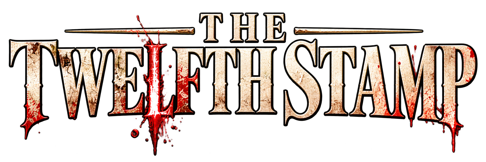
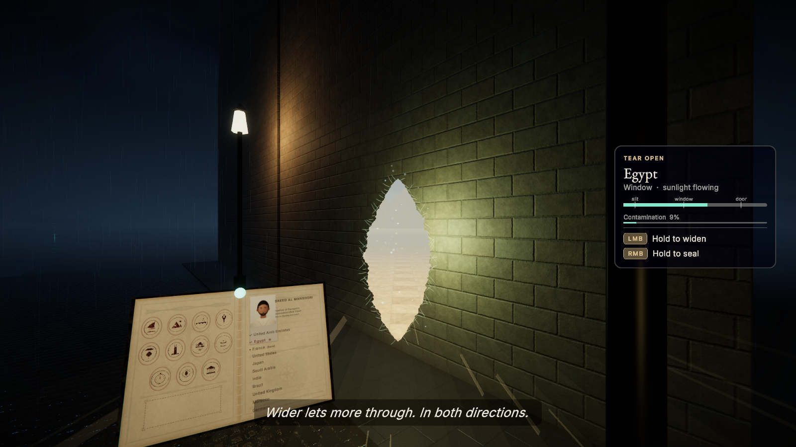
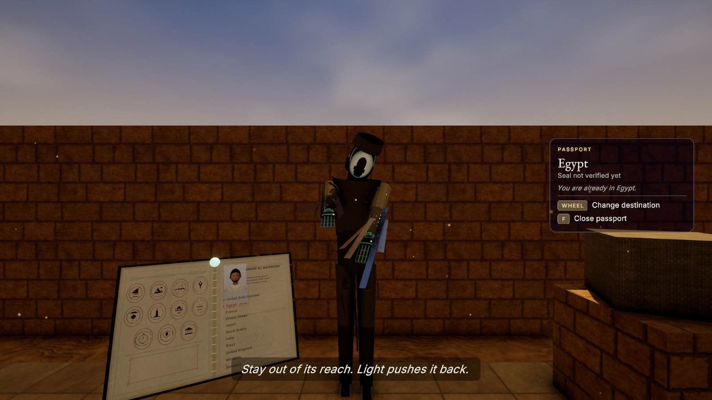
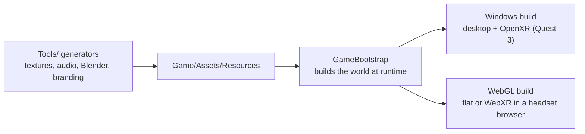

<p align="center">
  
</p>

<p align="center"><em>"You travelled alone. Something came back with you."</em></p>

<p align="center"><strong>A first-person survival-puzzle horror game for Meta Quest 3 (PC VR), keyboard and mouse, and the browser (WebXR).<br>Made in two days for the SHIFT Game Jam, 17–18 October 2026 (theme: <em>Festival of Passports</em>).</strong></p>

<p align="center">
  
  
  
  
  
  
  
</p>

<p align="center">
  
  
  <br><sub>Frames from the in-build automated QA run (<code>Docs/QA/run8</code>). A short VR gameplay clip is in <a href="WearingVR.mp4">WearingVR.mp4</a>.</sub>
</p>

> **Content warning:** horror for adults: loud jump scares, screams, growls, a figure that stalks and chases you, dark scenes and film grain. No visual gore. Set *Scare intensity* to *Gentle* for fewer, quieter scares and no jump scares.

## Overview

Saeed comes home from the Festival of Passports with eleven seals in his passport and a twelfth, **HOME**, that he never earned. It was forged by the Passenger, a figure of smoked glass that copies the places he remembers. The passport is your only tool: tear its seams open to borrow light and sound from the countries you visited, prove which seals are real, cancel the forgery in Berlin and find the one way home it cannot copy.

The Unity scene is empty: the game builds every level and menu from code when it starts, and most textures, sound effects and 3D models are produced by generator scripts kept in this repository.

## Features

- **Passport tears.** Aim at a stitched seam and hold to open a slit, widen it to a window or a door, and hold to seal it again. Light and sound come through from the chosen country (Egyptian sunlight into a rainy Paris night, for example), and a wider tear lets more through in both directions.
- **Eleven playable countries plus home**, each with its own encounter:

  | Country | Place | Encounter |
  |---|---|---|
  | United Arab Emirates | Abu Dhabi | Whack-a-Ghost |
  | Egypt | Giza exhibition court | The Temple Run |
  | France | Paris riverside checkpoint | Bubbles over the Seine |
  | United States | New York harbour terminal | Spot the Impostor |
  | Japan | Lantern street | The Claw Machine |
  | Saudi Arabia | Riyadh maze | The Maze |
  | India | Agra garden checkpoint | The Taj Mahal Puzzle |
  | Brazil | Rio carnival avenue | Carnival Ring Toss |
  | United Kingdom | London riverside | Stop the Clock |
  | Morocco | Marrakech, the shop | Memory Match |
  | Germany | Berlin festival pavilion | The Ghost Shooting Gallery |

- **Four levels on the welcome screen:** Easy (Japan, India, Saudi Arabia), Medium (six countries), Hard (the full story across all eleven) and Free Roam (every country, no threat). Easy and Medium end at the Victory Ground, a festival plaza with fireworks and three mini puzzles (Bell Echo, Lantern Row, Compass Dials).
- **The story (Hard):** a homecoming in Abu Dhabi, a playable flashback to the Marrakech shop, the glasses going on, a tutorial in a corrupted copy of the apartment, the countries in any order, then the Berlin finale: expose the forged doors with daylight, stamp VOID on the forgery and return to the real home for the epilogue.
- **The Passenger** stalks and chases you. Light pushes it back, and lamps you light make a pool it will not enter. A catch costs one of three hearts; a catch on the last heart ends the run, and Retry restarts from the last checkpoint.
- **Desktop and VR in one build.** VR offers teleport or smooth movement, snap or smooth turning, seated and left-handed modes, haptics, subtitles and reduced effects. The in-game Controls page is generated from the live input bindings.
- **Generated content.** Textures, stamps and passport pages come from seeded Python generators. Sound effects and music are synthesised in Python. The props, furniture, landmarks, VR controllers and the Passenger are built by Blender Python scripts, with a procedural fallback for every model.
- **Narration and audio.** 43 narrated lines in 5 synthetic voices with subtitles, 13 horror ambience loops, and 32 scare one-shots dropped around the player between set pieces (never over narration, chases, menus or pauses).
- **In-build automated tests.** `--autotest=<suite>` drives the real game systems, writes a Markdown report with screenshots and exits non-zero on any failed check.

## Tech Stack

| Area | Used |
|---|---|
| Engine | Unity 6000.6.2f1, Universal Render Pipeline 17.6, Input System 1.20 |
| XR | OpenXR 1.18 and XR Management 4.7 (Quest 3 as PC VR over Link); De-Panther WebXR Export for the browser build |
| Code | C# runtime and editor scripts, 9 custom shaders (tear mask and stencil, pocket-world lighting, beams, sky, planar mirror) |
| Content tools | Python (NumPy, SciPy, Pillow, soundfile) for textures and audio; Blender 5.2 Python scripts (with MPFB 2 for the player model) for 3D models |
| AI tools (disclosed) | Claude Code (code and generator scripts), ChatGPT image generation (key art, logo, icons, reference sheets), ElevenLabs Sound Effects (horror ambience and scares), Kokoro-82M text-to-speech (narration) |



## Getting Started

**Requirements:** Unity Hub with Unity **6000.6.2f1**, Windows Build Support, and WebGL Build Support for browser builds. For VR: a Meta Quest 3 connected with Meta Horizon Link (cable or Air Link), with Link set as the active OpenXR runtime in the Meta Horizon Link app.

### Play in the editor

1. Add the `Game/` folder in Unity Hub and open it with 6000.6.2f1.
2. Run **Twelfth Stamp > Run Project Setup** once (idempotent: layers, render settings, import rules).
3. Open `Assets/Scenes/Main.unity` and press Play. The scene is empty on purpose; `GameBootstrap` builds everything when it starts.

### Build from the command line

```bash
# Windows build (project setup + build). Default output: ../12th-Stamp-builds/Builds/Windows/TheTwelfthStamp.exe
Unity.exe -batchmode -nographics -quit -projectPath Game -executeMethod TwelfthStamp.EditorTools.BuildScript.SetupAndBuild -logFile build.log

# Browser build with WebXR (plays flat, switches to VR when a headset browser enters VR)
Unity.exe -batchmode -quit -buildTarget WebGL -projectPath Game -executeMethod TwelfthStamp.EditorTools.BuildScript.BuildWebXR -buildPath <output-folder>
```

`BuildWindows` and `BuildWeb` (WebGL without XR) are also available, and every build method accepts `-buildPath`. `Tools/install/Package-Release.ps1` packages a release ZIP, and `Install Shortcuts.cmd` (copied next to the exe) creates *Quest 3* and *Desktop* shortcuts.

### Run

```bash
TheTwelfthStamp.exe --mode=desktop      # keyboard and mouse (the default)
TheTwelfthStamp.exe --mode=vr           # Quest 3 over Link; offers Retry / Desktop Mode / Quit if VR cannot start
TheTwelfthStamp.exe --mode=desktop --demo                                 # 60-second judges' demo in Paris
TheTwelfthStamp.exe --mode=desktop --autotest=all --report-dir=<folder>   # automated test run
```

Other flags: `--no-intro`, `--save-dir=<folder>`. Test suites include `all`, `demo`, `egypt`, `story`, `countries`, `finale`, `levels`, `guide`, `explore`, `vrgames` and `arcade_a` to `arcade_d`.

### Regenerate content (optional)

The generators need Python with NumPy, SciPy and Pillow (the audio scripts also use soundfile), and Blender 5.2 for the model scripts.

```bash
python -I Tools/textures/gen_textures.py            # all textures and 2D graphics
python -I Tools/audio/make_sfx.py                   # synthesised sound effects
python -I Tools/branding/make_branding.py           # icons and branding derivatives from the approved key art
blender -b --factory-startup --python Tools/blender/build_props.py   # one of the Blender model scripts
```

## Controls

| Action | Keyboard and mouse | Quest 3 (right-handed default) |
|---|---|---|
| Move | W A S D or arrow keys | Left thumbstick (teleport, or smooth movement) |
| Run | Hold Left Shift | Push the left thumbstick fully forward (smooth movement) |
| Look / turn | Mouse | Look around; right thumbstick left / right to turn (snap turn by default) |
| Use, grab, put down | E | Trigger to use, grip to grab (either hand) |
| Passport | F | X |
| Choose destination | Mouse wheel, or `[` and `]` | B, or right thumbstick up / down |
| Open / widen a tear | Hold left mouse | Grip the seam and pull, or hold the right trigger |
| Seal the tear | Hold right mouse | Hold A |
| Recall carried item | R | Y |
| Objectives | Tab | Look at your passport |
| Full map | M | Not available in VR |
| Take the glasses off early | Hold G | Pause menu > Remove the glasses |
| Skip / continue | Space or Enter | Trigger |
| Pause | Esc | Menu button (left controller) |

Left-handed mode swaps the controller roles. In the browser VR build, pause is a press of the left thumbstick.

## Project Structure

```
12th-Stamp/
├── Game/                   Unity 6 project (URP)
│   └── Assets/
│       ├── Scripts/        Core, Cells (countries), Story, Passport, Passenger, Player, World, Guide, UI, Audio, Rendering, Input
│       ├── Shaders/        TS_* shaders (tears, pocket-world lighting, beams, sky, mirror)
│       ├── Editor/         ProjectSetup, BuildScript, WebXRSetup
│       ├── Resources/      generated textures, audio, narration and Blender FBX models
│       └── WebGLTemplates/ page template for the WebXR build
├── Tools/                  textures/, audio/, blender/, branding/, install/
├── Art/                    Blender sources, model previews, branding, reference notes
├── Audio/                  audio manifest, ElevenLabs set, narration script
└── Docs/                   handoff, pitch and demo script, credits and AI disclosure, QA reports
```

## Status

Version 0.9.0, the jam build. According to the commit log, the final jam build passed every automated in-build suite; the later WebXR commit has not had a full Windows test run yet, and no person has verified headset play or done a full listening pass (see [`Docs/QA/FinalReleaseGate.md`](Docs/QA/FinalReleaseGate.md)). There is no standalone Quest APK: the game runs on Quest 3 as PC VR over Link, or in a browser through WebXR.

## Team and Credits

**Awaiz Ahmed, Bilal Feroz, Mohammad Umar ([@Mohammad-Umar7](https://github.com/Mohammad-Umar7)) and Fuad Ahamed**: concept, direction, production, engineering, procedural modelling, sound synthesis and integration (as credited in the game).

- Fonts: Inter and EB Garamond (SIL Open Font License 1.1).
- Footsteps: Kenney.nl (CC0).
- Player body base: MakeHuman base mesh, targets and rig via MPFB 2 (CC0 assets).
- The full asset ledger and AI disclosure are in [`Docs/Credits_and_AI_Disclosure.md`](Docs/Credits_and_AI_Disclosure.md). The Festival of Passports, its documents and every character are fictional.

---

Built by [Awaiz Ahmed](https://github.com/4waiz) with Bilal Feroz, Mohammad Umar and Fuad Ahamed for the SHIFT Game Jam 2026.
